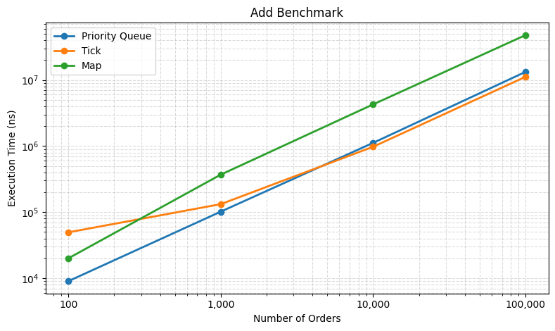
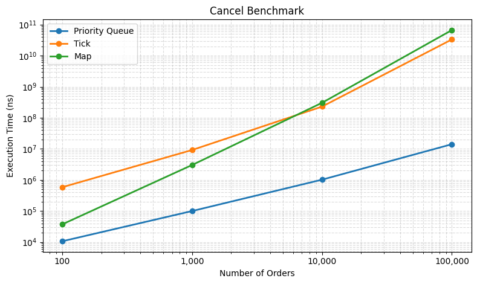
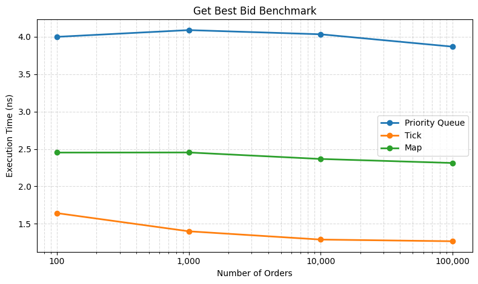
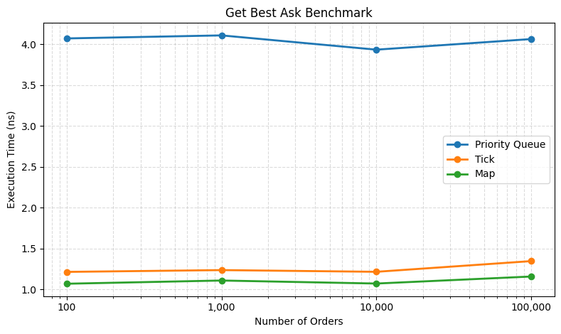

# cpp-trading-exchange

A high-performance trading exchange engine written in C++26.

The exchange implements core matching-engine components: order intake, a price-time-priority matching algorithm, and market-data dissemination — built with low-latency primitives such as lock-free queues, memory pools, and RDTSC timing.

## Quick Start

```bash
bazel build //...   # build everything
bazel test //...    # run all tests
```

See [BAZEL_BUILD.md](BAZEL_BUILD.md) for full build instructions, available targets, and compiler flags.

## Project Layout

```text
cpp-trading-exchange/
├── BUILD                       # Bazel build and test configuration
├── order.h                     # Order representation
├── order_book.h                # Priority Queue order book
├── order_book.cpp
├── tick_order_book.h           # Tick-based order book
├── tick_order_book.cpp
├── map_order_book.h            # Map-based order book
├── map_order_book.cpp
├── mem_pool.h                  # Memory pool utilities
├── exchange_main.h
├── exchange_main.cpp
├── containers_benchmark.cpp    # Performance benchmarks
├── BAZEL_BUILD.md              # Build instructions
├── README.md
└── graphs/                     # Benchmark result graphs
    ├── add_benchmark.png
    ├── cancel_benchmark.png
    ├── best_bid_benchmark.png
    └── best_ask_benchmark.png
```

## Performance Benchmarks

The project includes benchmarks comparing three different order book implementations:

- **Priority Queue:** Uses priority queues to organize orders.
- **Tick:** Uses a tick-indexed structure to organize orders by price.
- **Map:** Uses maps to organize price levels.

The implementations are compared across four operations using different order book sizes:

1. Adding orders
2. Canceling orders
3. Getting the best bid
4. Getting the best ask

All execution times are reported in nanoseconds (ns). Both axes in the graphs use logarithmic scales.

### Add Orders



The Priority Queue implementation performs best with smaller order counts. At larger order counts, the Tick implementation becomes slightly faster. The Map implementation has the highest execution time at larger sizes.

### Cancel Orders



The Priority Queue implementation is significantly faster than the other two implementations in these tests. The Tick and Map implementations show substantial increases in execution time as the number of orders grows.

### Get Best Bid



The Tick implementation has the lowest execution time across all tested order counts. The Map implementation is consistently second, while the Priority Queue implementation has the highest execution time.

### Get Best Ask



The Map implementation has the lowest execution time across all tested order counts. The Tick implementation performs similarly, while the Priority Queue implementation has the highest execution time.

## Raw Benchmark Data

All values below represent reported `real_time` measurements in nanoseconds.

### Add

| Number of Orders | Priority Queue | Tick | Map |
|---:|---:|---:|---:|
| 100 | 9,024.34 | 49,516.1 | 20,007.7 |
| 1,000 | 101,793 | 132,221 | 369,734 |
| 10,000 | 1,120,000 | 977,546 | 4,280,000 |
| 100,000 | 13,300,000 | 11,200,000 | 47,900,000 |

### Cancel

| Number of Orders | Priority Queue | Tick | Map |
|---:|---:|---:|---:|
| 100 | 10,643 | 584,226 | 37,307.7 |
| 1,000 | 99,956.2 | 9,200,000 | 3,030,000 |
| 10,000 | 1,020,000 | 229,000,000 | 303,000,000 |
| 100,000 | 14,100,000 | 33,200,000,000 | 66,400,000,000 |

### Get Best Bid

| Number of Orders | Priority Queue | Tick | Map |
|---:|---:|---:|---:|
| 100 | 4.00028 | 1.64194 | 2.45212 |
| 1,000 | 4.09046 | 1.39888 | 2.45347 |
| 10,000 | 4.03438 | 1.28812 | 2.36639 |
| 100,000 | 3.8689 | 1.26559 | 2.3127 |

### Get Best Ask

| Number of Orders | Priority Queue | Tick | Map |
|---:|---:|---:|---:|
| 100 | 4.07291 | 1.21453 | 1.06961 |
| 1,000 | 4.10995 | 1.23648 | 1.10885 |
| 10,000 | 3.93522 | 1.21556 | 1.07183 |
| 100,000 | 4.06501 | 1.34644 | 1.15779 |

## Running the Benchmarks

From the project root, run:

```bash
bazel run -c opt //:containers_benchmark -- --benchmark_out="$PWD/benchmark_results.csv" --benchmark_out_format=csv
```

This runs the benchmark target and exports the results to a CSV file.

## Notes and Limitations

The benchmark output displayed a warning indicating that the Google Benchmark library was built in DEBUG mode. This can affect timing accuracy, even when the benchmark target is run with `-c opt`.

The results should therefore be treated as preliminary until the benchmark library is confirmed to be built in an optimized configuration.

The reported values are Google Benchmark `real_time` measurements. Their interpretation depends on how many operations each benchmark iteration performs. They should not automatically be interpreted as the latency of a single order operation without checking the benchmark implementation.

Results may also vary depending on hardware, compiler settings, and workload characteristics.